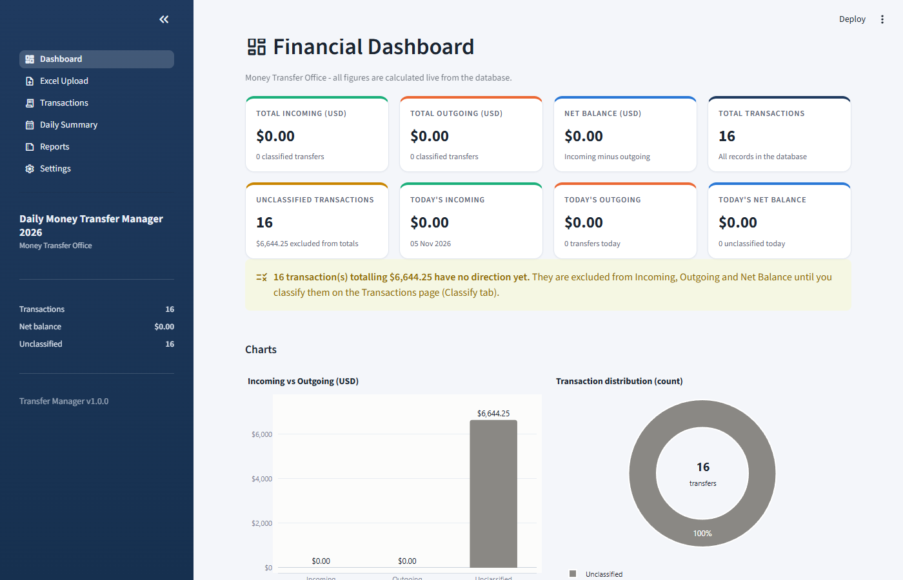
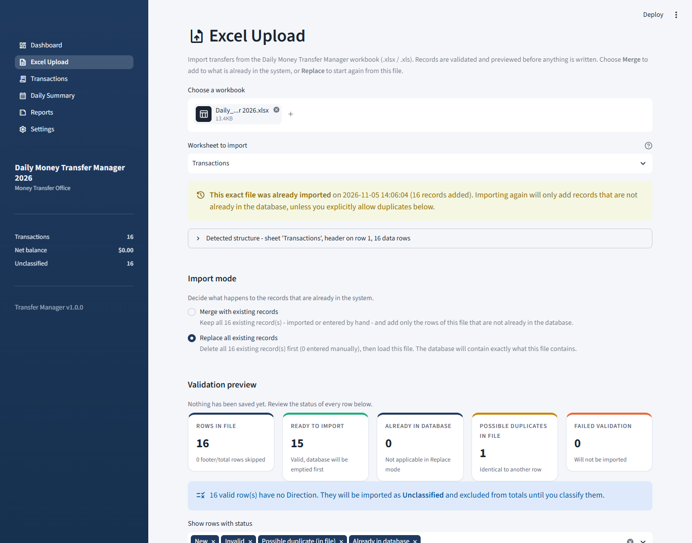
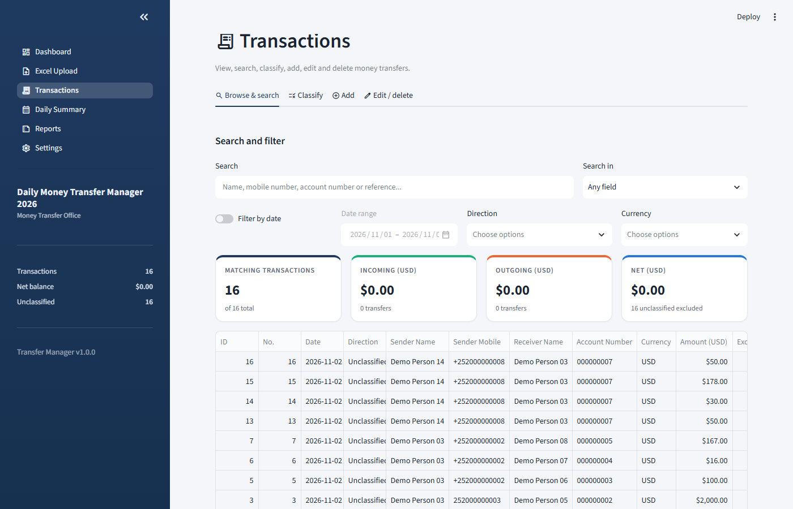
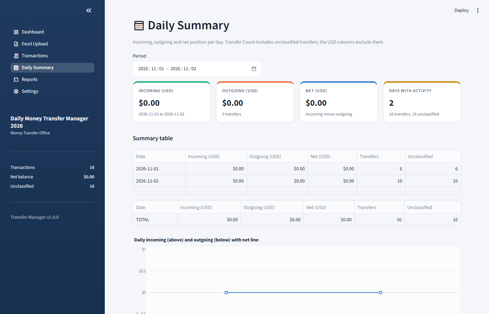
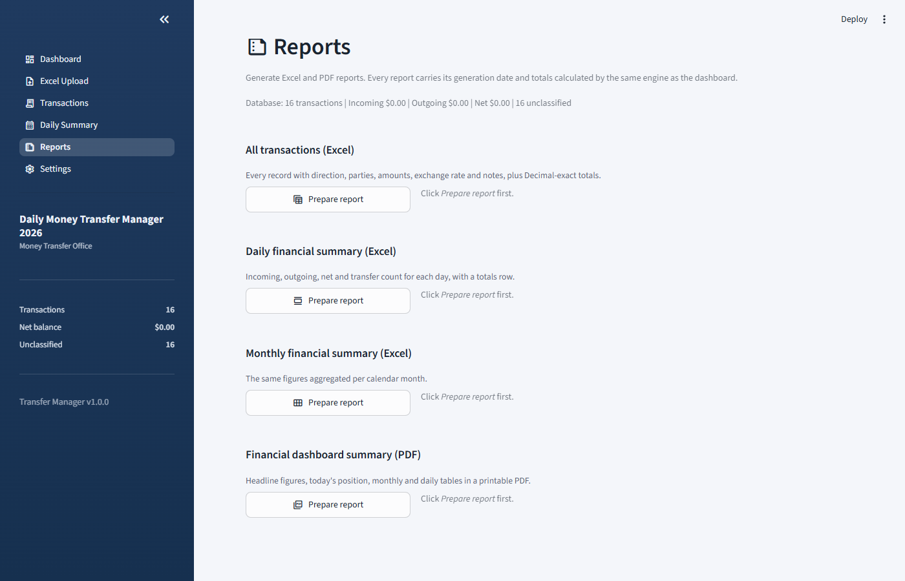
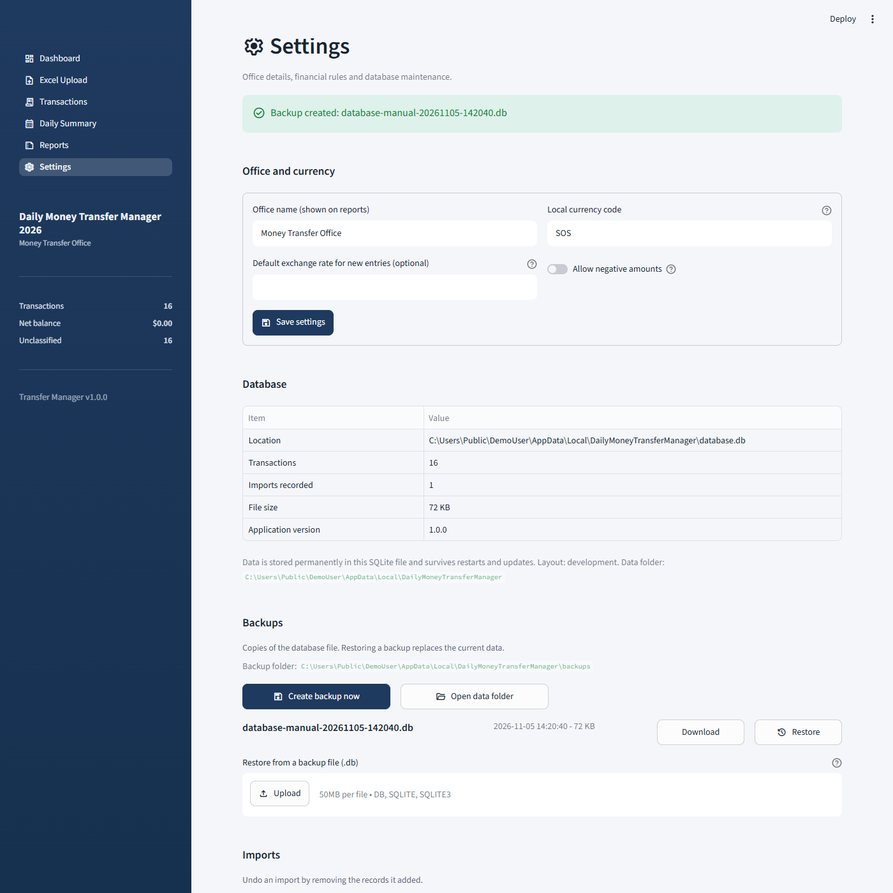

# Daily Money Transfer Manager 2026

A Windows desktop application for money-transfer offices: import the daily
transfer workbook, classify transfers as incoming or outgoing, see the balance
dashboard, and produce Excel and PDF reports. All data stays on the computer
in a local SQLite database. No Python, browser set-up or internet connection
is needed.

> **Download:** the latest `DailyMoneyTransferManager-Setup.exe` is published on the
> [Releases page](https://github.com/Mohamed-Qadar/Financial_Dashboard/releases). See [Installation](#installation).

## Contents

- [Features](#features)
- [Screenshots](#screenshots)
- [System requirements](#system-requirements)
- [Installation](#installation)
- [Where your data is stored](#where-your-data-is-stored)
- [Backups and restore](#backups-and-restore)
- [Updating and uninstalling](#updating-and-uninstalling)
- [Troubleshooting](#troubleshooting)
- [Financial rules](#financial-rules)
- [Running from source](#running-from-source)
- [Building the Windows application](#building-the-windows-application)
- [Publishing a release on GitHub](#publishing-a-release-on-github)
- [Version history](#version-history)
- [License](#license)

## Features

| Area | What it does |
|---|---|
| **Excel Upload** | Reads the *Transactions* sheet of `.xlsx`/`.xlsm`/`.xls` files, detects the header row and the 12 expected columns, validates dates and numbers, flags missing values, detects duplicates (within the file and against the database), previews successful and failed rows, and only writes after you confirm. Two import modes: **Merge** (default) keeps every existing record and adds only new rows; **Replace** deletes every existing record - imported or entered by hand - and loads the file from scratch, after an explicit confirmation. |
| **Dashboard** | Total Incoming, Total Outgoing, Net Balance, Total Transactions, Unclassified Transactions, Today's Incoming / Outgoing / Net, plus charts: Incoming vs Outgoing, daily volume, monthly trend and transaction distribution. Everything is calculated from the database on every view. |
| **Transactions** | Browse, search (sender, receiver, mobile, account, notes), filter by date, direction and currency, classify transfers as Incoming/Outgoing, add, edit and delete (with confirmation). |
| **Daily Summary** | Date, Incoming (USD), Outgoing (USD), Net (USD), Transfer Count per day, with a chart, local-currency totals kept separately, and an Excel export. |
| **Reports** | All transactions (Excel), daily summary (Excel), monthly summary (Excel), dashboard summary (PDF). Each report carries its generation date and Decimal-exact totals. |
| **Settings** | Office name, local currency, default exchange rate, negative-amount rule, database backups and restore, import history with undo (removes only the records that import added; manual records stay), database information, delete-all. |

The desktop edition adds a native window, automatic start and stop of the
local application server, a loading screen, a single-instance guard, readable
error pages and log files.

## Screenshots

| Dashboard | Excel Upload (Replace mode) |
|---|---|
|  |  |

| Transactions | Daily Summary |
|---|---|
|  |  |

| Reports | Settings - backups |
|---|---|
|  |  |

## System requirements

- Windows 10 (version 1809 or later) or Windows 11, 64-bit.
- Microsoft Edge WebView2 Runtime. It is part of Windows 11 and of every
  Windows 10 PC that has Microsoft Edge. If it is missing, the installer and
  the application tell you and point to the free download from Microsoft.
- About 400 MB of free disk space, 4 GB RAM.
- No administrator rights, no Python, no internet connection after installation.

## Installation

### Installer (recommended)

1. Open <https://github.com/Mohamed-Qadar/Financial_Dashboard/releases> and download
   `DailyMoneyTransferManager-Setup.exe` from the latest release.
2. Optional but recommended: compare the file's SHA-256 with `SHA256SUMS.txt`
   from the same release. In PowerShell:
   ```powershell
   Get-FileHash -Algorithm SHA256 .\DailyMoneyTransferManager-Setup.exe
   ```
3. Run the installer. It installs for the current user only
   (`%LOCALAPPDATA%\Programs\DailyMoneyTransferManager`) and needs no
   administrator password. Choose whether you want a desktop shortcut.
4. Start **Daily Money Transfer Manager 2026** from the Start menu or the
   desktop shortcut. A loading screen appears for a few seconds while the local
   server starts, then the application opens in its own window.

Windows SmartScreen may show "Windows protected your PC" the first time because
the executable is not code-signed. Click **More info**, then **Run anyway**,
after checking the SHA-256 value.

### Portable edition

`DailyMoneyTransferManager-Portable.zip` contains the same application plus a
`portable.txt` marker. Extract the ZIP anywhere (for example a USB stick) and
run `DailyMoneyTransferManager.exe`. In portable mode all data is kept in the
`data` folder next to the executable instead of `%LOCALAPPDATA%`.

## Where your data is stored

| Edition | Folder |
|---|---|
| Installed | `%LOCALAPPDATA%\DailyMoneyTransferManager` (for example `C:\Users\<you>\AppData\Local\DailyMoneyTransferManager`) |
| Portable | `data\` next to `DailyMoneyTransferManager.exe` |
| Running from source | `data\` inside the project folder |

Inside that folder:

| Item | Purpose |
|---|---|
| `database.db` | The SQLite database with every transaction, import record and setting. |
| `backups\` | Manual backups, automatic pre-restore and pre-migration copies. |
| `exports\excel\`, `exports\reports\` | Copies of generated Excel and PDF reports. |
| `logs\launcher.log`, `logs\server.log` | Diagnostic logs of the desktop launcher and of the local server. |

The database is never stored inside the program folder or in a temporary
folder, so updating or reinstalling the application does not touch it. The
Settings page shows the exact paths and has an **Open data folder** button.

## Backups and restore

- **Settings > Backups > Create backup now** writes a consistent copy of the
  database (using SQLite's online backup) to the `backups` folder, named
  `database-manual-YYYYMMDD-HHMMSS.db`.
- Each backup can be **downloaded** (to keep it elsewhere) or **restored**.
  Restoring asks you to type `RESTORE`, validates the file, saves the current
  database as `database-pre-restore-...db` first, and then replaces the data.
- **Restore from a backup file** lets you pick a `.db` file from anywhere, for
  example a backup copied from another PC.
- Before a database schema migration (after an update that changes the data
  structure) the application automatically writes `database-pre-migration-...db`.
- Uninstalling the application keeps the data folder; the uninstaller tells
  you where it is.

Copying the whole data folder to an external drive is also a valid backup.

## Updating and uninstalling

- **Update:** download and run the newer `DailyMoneyTransferManager-Setup.exe`.
  It replaces the program files in place; the database, backups and settings
  are preserved. The application must be closed during the update (the
  installer asks if it is running).
- **Uninstall:** *Settings > Apps* in Windows or *Uninstall Daily Money
  Transfer Manager 2026* in the Start menu. The data folder is left in place
  on purpose; delete `%LOCALAPPDATA%\DailyMoneyTransferManager` yourself if you
  really want to remove all records.

## Troubleshooting

| Symptom | What to do |
|---|---|
| "Daily Money Transfer Manager 2026 is already running" | The application is a single-instance program. Look for its window on the taskbar; if none is visible, end `DailyMoneyTransferManager.exe` in Task Manager and start again. |
| The loading screen stays for more than a minute, or "The application could not start" | Open `%LOCALAPPDATA%\DailyMoneyTransferManager\logs\server.log`. Typical causes are a security product blocking the local server, or a damaged installation (reinstall). |
| Message about the WebView2 Runtime | Install the *Evergreen* WebView2 Runtime from Microsoft's WebView2 page, then start the application again. |
| Windows SmartScreen blocks the installer | The installer is not code-signed. Verify the SHA-256 from the release page, then choose *More info > Run anyway*. |
| An Excel file is rejected | The *Transactions* sheet needs at least the columns Date, Sender Name, Receiver Name and Amount (USD) in the first 15 rows. The upload page shows which columns were detected and which rows failed and why. |
| Figures look wrong after an import | Imported rows without a Direction are *Unclassified* and are excluded from totals until you classify them on the Transactions page. |
| I want to start again from a file | Use **Replace** mode on the Excel Upload page (it creates no backup by itself, so create one first), or *Settings > Delete all transactions*. |

Log files are plain text and contain no transaction details beyond counts; you
can share them when asking for help.

## Financial rules

- Amounts in USD are stored as integer cents and calculated with `Decimal`;
  totals are never computed with floating-point arithmetic.
- `Net Balance = Total Incoming - Total Outgoing`. Unclassified transfers are
  counted in *Total Transactions* but excluded from every USD total until they
  are classified.
- Duplicate detection compares date, sender, receiver, amount and notes; the
  direction and the row number are ignored so a re-classified row is still
  recognised.
- Existing records are never modified by an import in Merge mode. Replace mode
  deletes all records and loads the file inside one SQL transaction, so a failed
  load leaves the previous data untouched.
- Every total shown on the Dashboard, Daily Summary and in the reports is
  recomputed from the database on each view and checked against an independent
  sum.

These rules are covered by the automated test-suite (`tests/`).

## Running from source

Requirements: Python 3.11 or 3.12 on Windows.

```powershell
git clone https://github.com/Mohamed-Qadar/Financial_Dashboard.git
cd Financial_Dashboard
python -m venv .venv
.\.venv\Scripts\activate
pip install -r requirements.txt
python -m streamlit run app.py          # browser edition, http://localhost:8501
```

For the desktop window during development, also install the desktop extras and
start the launcher instead of Streamlit:

```powershell
pip install -r requirements-desktop.txt
python desktop_main.py                  # native window, local server on a free port
python desktop_main.py --self-test      # starts, loads the app, closes, writes logs\self-test.json
```

Run the tests with `python -m pytest -q`.

Project layout:

| Path | Content |
|---|---|
| `app.py` | Streamlit entry point and navigation. |
| `desktop_main.py` | Windows desktop launcher (native window + local server). |
| `config.py` | Paths, column definitions, business constants. |
| `core/` | Database, Excel reader, validator, calculations, reports (no UI code). |
| `ui/` | One module per page. |
| `tests/` | pytest suite (financial rules, import workflow, backups, launcher helpers). |
| `sample_data/` | Example workbook with the expected layout. All names, phone numbers and account numbers in it are synthetic. |
| `tools/` | Icon generator, packaged-build smoke test, release-notes extractor, sample-data anonymiser. |
| `requirements.txt`, `requirements-desktop.txt`, `requirements-lock.txt` | Pinned runtime deps, desktop build extras, full reproducible lock. |
| `desktop.spec`, `installer.iss`, `build_windows.ps1` | Packaging. |
| `.github/workflows/build-windows.yml` | CI build and release workflow. |

## Building the Windows application

Prerequisites on the build machine: Python 3.12 from python.org (the Microsoft
Store Python is not suitable for PyInstaller), and Inno Setup 6
(`winget install JRSoftware.InnoSetup`).

```powershell
python -m venv .venv-build
.\.venv-build\Scripts\python -m pip install -r requirements-lock.txt
.\build_windows.ps1
```

The script runs the tests, generates the icon, builds the one-folder
executable with PyInstaller (`dist\DailyMoneyTransferManager\`), creates
`dist\DailyMoneyTransferManager-Portable.zip`, compiles
`dist\installer\DailyMoneyTransferManager-Setup.exe` and writes
`dist\SHA256SUMS.txt`. Use `-SkipTests` or `-SkipInstaller` to shorten the run.

To check a build without a display (this is what CI does):

```powershell
python tools\smoke_test_bundle.py dist\DailyMoneyTransferManager\DailyMoneyTransferManager.exe
```

To check the real window: `dist\DailyMoneyTransferManager\DailyMoneyTransferManager.exe --self-test`
opens the application, waits, closes it and writes `logs\self-test.json` in
the data folder.

## Publishing a release on GitHub

The workflow in `.github/workflows/build-windows.yml` builds on every push and
pull request (artifacts only) and publishes a **GitHub Release** when a version
tag is pushed.

1. Set the new version in `config.py` (`APP_VERSION`) and add a section to
   `CHANGELOG.md` with the same number.
2. Commit, then tag and push:
   ```powershell
   git tag v1.0.0
   git push origin main --tags
   ```
3. The workflow checks that the tag matches `APP_VERSION`, runs the tests,
   builds the installer and the portable ZIP, smoke-tests the packaged server,
   and creates the release with:
   - `DailyMoneyTransferManager-Setup.exe`
   - `DailyMoneyTransferManager-Portable.zip`
   - `SHA256SUMS.txt`
   - release notes taken from the matching `CHANGELOG.md` section.
4. Check the release page, then share its link. Users download the installer
   from there.

Nothing private is uploaded: the repository ignores `data/`, `dist/`, `build/`
and local virtual environments, and the build runs on a fresh GitHub-hosted
Windows runner.

## Version history

See [CHANGELOG.md](CHANGELOG.md).

## License

No license has been selected for this repository yet. Until one is added, all
rights are reserved by the project owner.
